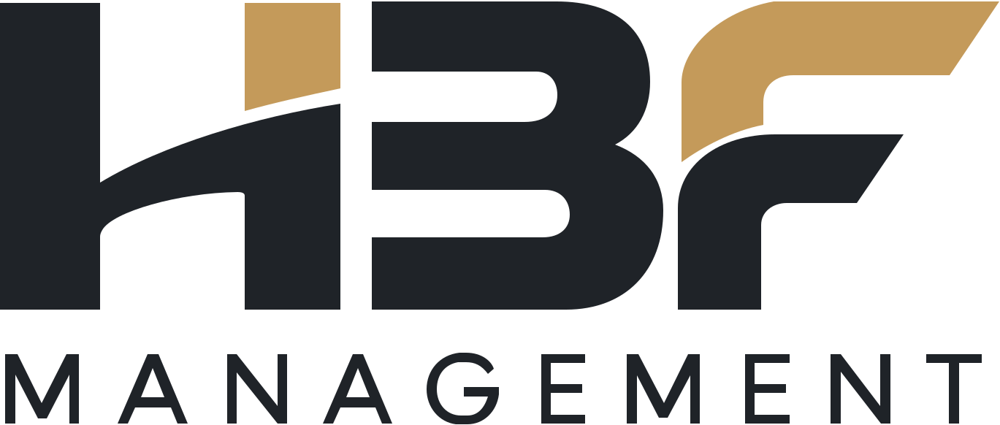

  <a href="https://hbf.pl/">
    <picture>
      <source media="(prefers-color-scheme: dark)" srcset="./hbf-logo-dark.svg">
      
    </picture>
  </a>

<h3 align="center">Obsługa IT dla firm — przejmujemy odpowiedzialność za Twoje środowisko IT</h3>

  Całe IT albo wybrany obszar: użytkownicy, serwery, sieć, Microsoft 365, kopie zapasowe i bezpieczeństwo. 
  Ponad 25 lat praktycznego doświadczenia · Katowice

  <a href="https://hbf.pl/"><b>hbf.pl</b></a> ·
  <a href="https://hbf.pl/oferta.php">Oferta i ceny</a> ·
  <a href="https://hbf.pl/jak-mozemy-pomoc.php">Jak możemy pomóc</a> ·
  <a href="https://hbf.pl/kontakt.php">Kontakt</a>

---

### Czym się zajmujemy

| | |
|---|---|
| **Stała opieka IT** | Użytkownicy, stanowiska, konta, dostawcy i codzienne zgłoszenia. |
| **Serwery i firmowe systemy** | Usługi, na których pracuje firma: ich stan, aktualizacje i możliwość odtworzenia. |
| **Sieć i bezpieczny dostęp** | Wi‑Fi, połączenia między urządzeniami i lokalizacjami, bezpieczna praca zdalna. |
| **Microsoft 365 i poczta** | Konta pracowników, poczta, dostęp do danych, uprawnienia i bieżąca administracja. |
| **Kopie zapasowe i bezpieczeństwo** | Sprawdzamy, czy kopie powstają i czy da się z nich odtworzyć firmę po awarii. |
| **Zmiany i projekty IT** | Nowe biuro, migracja, wymiana serwera — bez zatrzymywania pracy firmy. |

### W czym pomagamy najczęściej

- **Nie ma już osoby od IT** — zaczynamy od dostępów, backupu i usług krytycznych. Nie musisz mieć listy serwerów ani haseł. → [Przejęcie IT](https://hbf.pl/przejecie-it.php)
- **Nie wiesz, czy IT jest pod kontrolą** — infrastruktura, sieć, backup, Microsoft 365, licencje i dostępy, z raportem i rekomendacjami. → [Audyt IT](https://hbf.pl/audyt-it.php)
- **Nowa firma lub przeprowadzka biura** — komputery, sieć, Wi‑Fi, poczta, domena, backup i VPN, zanim zespół zacznie pracę. → [Nowa firma, nowe biuro](https://hbf.pl/nowa-firma-nowe-biuro.php)
- **Masz własny dział IT** — projekty, migracje, serwery, sieci, automatyzacja i chmura jako wsparcie zespołu. → [Dla firm z własnym IT](https://hbf.pl/dla-korporacji.php)
- **Biura rachunkowe** — środowiska InsERT, serwery, backup, praca zdalna i podpis elektroniczny. → [IT dla biur rachunkowych](https://hbf.pl/it-dla-biur-rachunkowych.php)
- **Podpis kwalifikowany i e‑Doręczenia** — jako Autoryzowany Partner Certum. → [Usługi kwalifikowane](https://hbf.pl/uslugi-kwalifikowane.php)

### Jak zaczynamy

1. **Krótka rozmowa** — liczba użytkowników, kluczowe systemy, obecne problemy i oczekiwany zakres.
2. **Rozpoznanie i priorytety** — co już działa, gdzie są zależności i ryzyka.
3. **Zakres, czasy reakcji i start** — model współpracy, zasady zgłoszeń i kolejność najważniejszych zmian.

### Kontakt

📞 [+48 666 155 165](tel:+48666155165) · 🌐 [hbf.pl/kontakt](https://hbf.pl/kontakt.php) · 🛟 [Zdalna pomoc](https://hbf.pl/pomoc.php)

HBF Management · ul. Melchiora Wańkowicza 3, 40-384 Katowice · Autoryzowany Partner Certum · sieć sprzedaży InsERT · Rzetelna Firma
